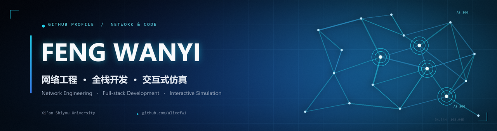

  

  

  
  
  
  

  

## 关于我 · About Me

网络工程本科生 @ 西安石油大学，关注网络协议与安全、全栈工程化，以及用交互式可视化把复杂系统讲清楚。

*Network Engineering undergraduate at Xi'an Shiyou University. I care about network protocols and security, production-minded full-stack engineering, and making complex systems legible through interactive visualization.*

- **现在 · Now** — 把课程实验做成可复现、可演示的完整项目。
- **方法 · Approach** — 从需求、设计到实现与文档，尽量交付“能跑、能讲、能复用”的作品。
- **开放 · Open** — 欢迎 Issue、PR，或关于网络 / 前端 / 可视化的交流。

## 技术栈 · Tech Stack

  

- **网络 · Networking** — Cisco IOS · Packet Tracer · Wireshark · VLAN / OSPF / BGP / HSRP · IPsec VPN · NAT / ACL / AAA
- **工程 · Engineering** — Java · Spring Boot · MyBatis · MySQL · REST API · JWT · Docker · Git / Linux
- **可视化 · Visualization** — JavaScript · Plotly · ECharts · Canvas · 3D / 2D simulation

  

## 精选项目 · Featured Projects

<table>
<tr>
<td width="50%" valign="top">

<h3><a href="https://github.com/alicefw1/lab-management">01 · 实验室综合管理系统</a></h3>

高校实验室全流程管理平台：设备借用、预约、报修、耗材与危化品管理，JWT 角色权限与 ECharts 数据看板。

Full-stack lab operations platform with JWT RBAC, equipment workflows, and ECharts dashboards.

<code>Spring Boot</code> <code>MyBatis</code> <code>MySQL</code> <code>ECharts</code>

</td>
<td width="50%" valign="top">

<h3><a href="https://github.com/alicefw1/cumcm-2025-smoke-interference-sim">02 · 烟幕干扰仿真</a></h3>

2025 全国大学生数学建模竞赛 A 题：离线 Plotly 三维场景、三视图与 184 条视线遮挡判定。

Interactive 3D/2D simulation for CUMCM 2025 Problem A, with offline Plotly and 184 sightline samples for occlusion tests.

<code>JavaScript</code> <code>Plotly</code> <code>3D Visualization</code>

<a href="https://alicefw1.github.io/cumcm-2025-smoke-interference-sim/"><strong>在线体验 →</strong></a>

</td>
</tr>
<tr>
<td width="50%" valign="top">

<h3><a href="https://github.com/alicefw1/d4rt-paper-lab">03 · D4RT 论文实验室</a></h3>

把 CVPR 2026 最佳论文做成可交互教学仪器：五维查询矩阵 + Python / JS 双实现一致性校验。

An interactive lab for the CVPR 2026 best paper D4RT, with a 5D query matrix and Python/JS consistency checks.

<code>JavaScript</code> <code>Python</code> <code>Canvas</code>

</td>
<td width="50%" valign="top">

<h3><a href="https://github.com/alicefw1/smb-enterprise-network">04 · 中小企业网络实验</a></h3>

总部 + 分支机构 + 双 ISP 的 Cisco Packet Tracer 实验：VLAN、OSPF、BGP、HSRP、IPsec VPN、NAT / ACL / AAA。

A two-site enterprise network lab covering VLAN, OSPF, BGP, HSRP, IPsec VPN, NAT, ACL, and AAA.

<code>Cisco IOS</code> <code>Packet Tracer</code> <code>Network Design</code>

</td>
</tr>
</table>

  另外还有 <a href="https://github.com/alicefw1/taxi-meter-logisim">出租车计价器 · Logisim 数字电路</a>，以及 <a href="https://github.com/alicefw1?tab=repositories">全部 5 个公开仓库 →</a>

  

## GitHub 数据 · GitHub Stats

  
  

  

## 贡献 · Contribution

  <picture>
    <source media="(prefers-color-scheme: dark)" srcset="https://raw.githubusercontent.com/alicefw1/alicefw1/output/github-contribution-grid-snake-dark.svg" />
    <source media="(prefers-color-scheme: light)" srcset="https://raw.githubusercontent.com/alicefw1/alicefw1/output/github-contribution-grid-snake.svg" />
    
  </picture>

  

## 联系 · Contact

- **GitHub** — [@alicefw1](https://github.com/alicefw1)
- **University** — [西安石油大学](https://www.xsyu.edu.cn/)

  如果你对网络工程、全栈开发或交互式可视化感兴趣，欢迎在 GitHub 上交流。 
  If you're interested in network engineering, full-stack development, or interactive visualization, feel free to reach out on GitHub.

  “Build networks. Ship software. Explain clearly.” 
  Designed & built with care

